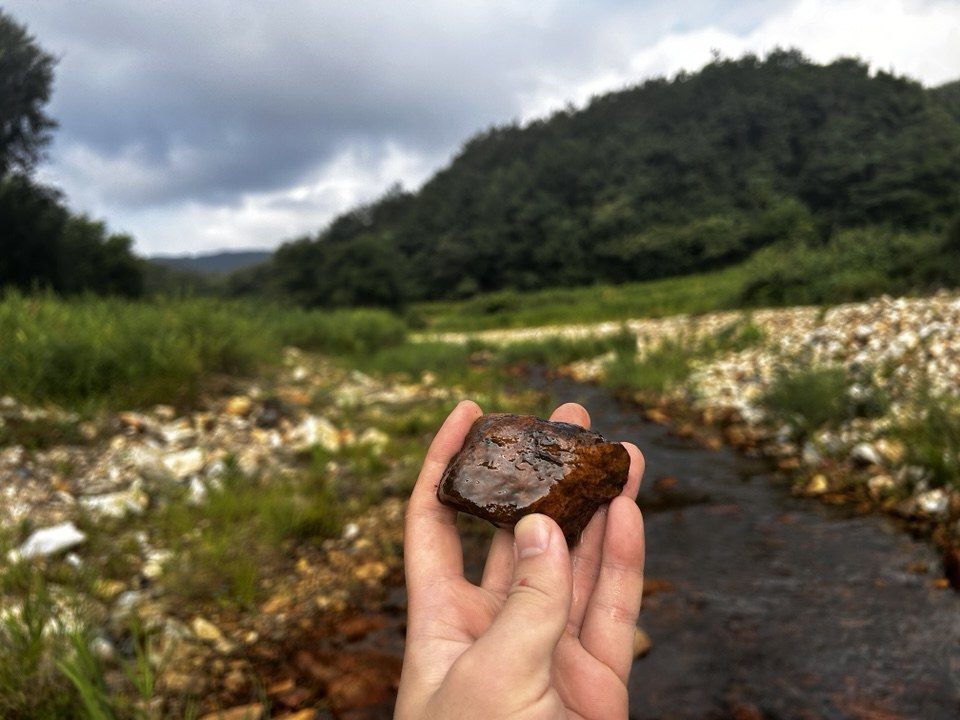
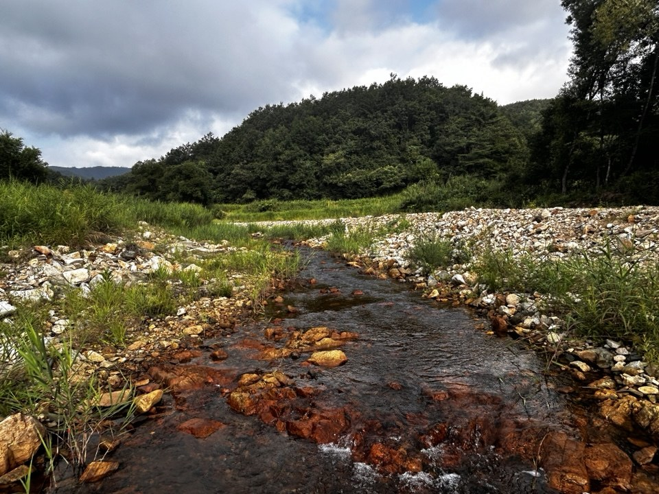
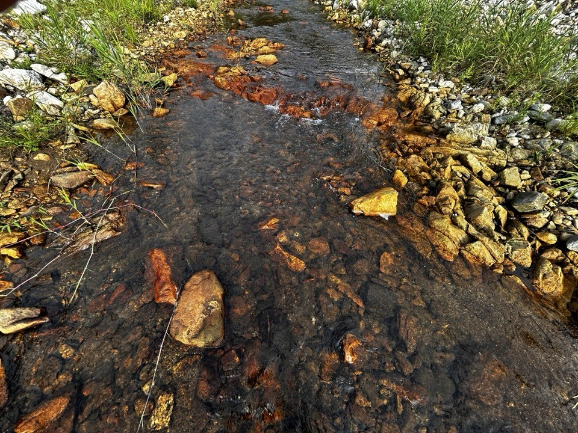
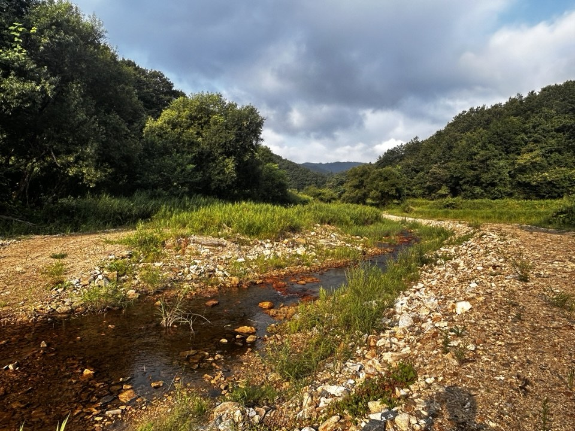

<aside class="myeongpa-document-note">

애기난골은 명파 마을 서쪽에 있는 골짜기입니다. 이름만 들으면 작고 귀여운 장소처럼 느껴지지만, 실제로 전해지는 이야기는 꽤 강렬합니다. 병자호란 때 피난을 온 여인이 이곳에서 아기를 낳았고, 그때 흘린 피가 골짜기를 붉게 물들여 마을에 침입하려던 세력이 물러났다는 전설이 전해집니다.

</aside>

<figure class="myeongpa-document-figure"><figcaption>전설 속 붉은 흔적을 실제 물질처럼 느끼게 했던 붉은 돌.</figcaption></figure>

주민들마다 이야기의 세부 내용은 조금씩 달랐지만, 공통적으로 남아 있는 핵심은 분명했습니다. 한 여인이 이곳에서 아기를 낳았고, 골짜기를 붉게 물들인 피가 있었으며, 그 붉은 흔적이 마을을 지켰다는 것입니다. 그래서 애기난골은 단순한 골짜기가 아니라, 출산과 피, 위험과 생존, 그리고 마을의 안정이 함께 얽힌 장소처럼 느껴졌습니다.

애기난골로 가는 길은 쉽지 않았습니다. 명파 마을 조제암길을 따라 서쪽으로 가 검문소를 지나고, 물길을 따라 깊숙이 이동해야 닿을 수 있는 곳입니다. 길은 좁고 험했고, 일반 차량보다 경운기로 접근해야 할 만큼 외진 장소처럼 느껴졌습니다.

실제로 이 장소를 떠올릴 때 가장 먼저 생각나는 것은 붉은 물입니다. 사진 속 물길을 보면, 계곡의 물은 투명하게 흐르면서도 바닥과 돌 주변에 붉은빛이 강하게 남아 있습니다. 처음에는 전설 속 피의 이미지가 떠올라 조금 섬뜩하게 느껴지기도 했습니다. 하지만 가까이 보니 그 붉음은 무섭다기보다 신기한 자연의 색에 가까웠습니다.

<figure class="myeongpa-document-figure"><figcaption>붉은 빛이 남아 있는 애기난골의 물길. 전설 속 피의 이미지와 실제 자연현상이 겹쳐 보인다.</figcaption></figure>

주민들은 이 붉은 빛이 인근 광산에서 흘러나오는 철 성분 때문이라고 설명했습니다. 저는 손에 들어 올린 붉은 돌을 보며, 전설로만 들었던 피의 이미지가 물과 돌과 흙의 색으로 실제로 만져지는 듯한 느낌을 받았습니다. 정확히 말하면 그것은 피가 아니라 철 성분이 만들어낸 자연현상에 가까울 것입니다. 하지만 전설을 들은 뒤 이 붉은 물과 돌을 보면, 사람들은 자연스럽게 오래된 이야기를 떠올리게 됩니다.

애기난골은 무서운 장소라기보다, 전설과 실제 자연이 겹쳐 있는 장소였습니다. 물은 맑게 흐르고 있었고, 주변에는 숲과 풀, 하얀 돌과 붉은 돌이 함께 있었습니다. 하늘은 어둡게 흐려져 있었고, 산과 골짜기는 깊게 둘러싸여 있었습니다. 그 풍경은 평범한 계곡처럼 보이면서도, 어딘가 설명하기 어려운 긴장감과 신비로움을 가지고 있었습니다.

<figure class="myeongpa-document-figure"><figcaption>물속의 붉은 돌과 바닥. 철 성분으로 보이는 색이 전설의 분위기를 더한다.</figcaption></figure>

저는 이 장소를 보며, 명파의 이야기는 완전히 사라진 것이 아니라 땅과 물속에 아직 남아 있다는 생각을 했습니다. 애기난골의 전설이 사실인지 아닌지는 제가 단정할 수 없습니다. 하지만 중요한 것은, 주민들이 이 장소를 그렇게 기억해왔고, 실제 현장에는 그 이야기를 떠올리게 만드는 붉은 물과 돌이 남아 있었다는 점입니다.

그림에서는 애기난골을 단순히 무서운 피의 계곡으로 그리고 싶지 않았습니다. 이곳은 피의 전설을 가진 장소이지만, 동시에 맑은 물과 생태가 살아 있는 골짜기였습니다. 그래서 저는 붉은색만 강조하기보다, 물과 돌, 산과 하늘, 그리고 장소가 가진 이상한 생명력을 함께 담고 싶었습니다.

전설 속 피는 이 그림에서 단순한 공포가 아니라, 마을을 지킨 색이기도 합니다. 여인이 흘린 피가 위협을 막았다는 이야기는 슬프고 무겁지만, 동시에 생명을 낳고 마을을 지켜낸 이야기처럼 느껴졌습니다. 그래서 애기난골의 붉은 물은 제게 무서운 색이면서도, 이상하게 생명력 있는 색이었습니다.

사진 속 붉은 물길과 돌은 제가 그림을 그릴 때 가장 중요한 이미지가 되었습니다. 물 위로 드러난 붉은 돌들은 전설의 흔적처럼 보였고, 손에 든 붉은 돌은 마치 그 이야기를 실제로 만져본 순간처럼 느껴졌습니다. 멀리 보이는 산과 흐린 하늘은 애기난골이 쉽게 닿을 수 없는 깊은 장소라는 느낌을 더해주었습니다.

<figure class="myeongpa-document-figure"><figcaption>깊은 산과 흐린 하늘, 물길이 이어지는 애기난골의 전체 분위기.</figcaption></figure>

제게 애기난골은 전설을 확인하러 간 장소라기보다, 전설이 왜 생겨났는지 조금은 이해하게 된 장소였습니다. 붉은 물이 흐르는 골짜기, 그 물을 따라 전해진 피의 이야기, 그리고 실제로 그곳까지 가야만 느낄 수 있는 깊은 고요함이 있었습니다.

이 그림은 애기난골의 전설을 그대로 설명하는 그림이 아닙니다. 오히려 제가 그 장소에 도착했을 때 느꼈던 이상한 감정, 즉 무서움과 아름다움, 피의 이야기와 맑은 물, 죽음의 이미지와 생명의 이미지가 동시에 있는 감각을 한 화면에 담아보려 한 작업입니다.

