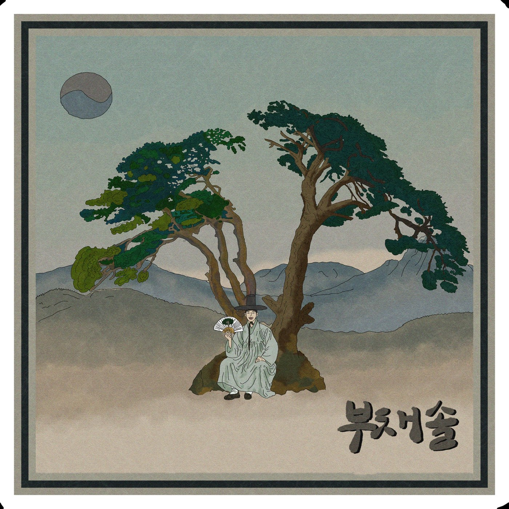
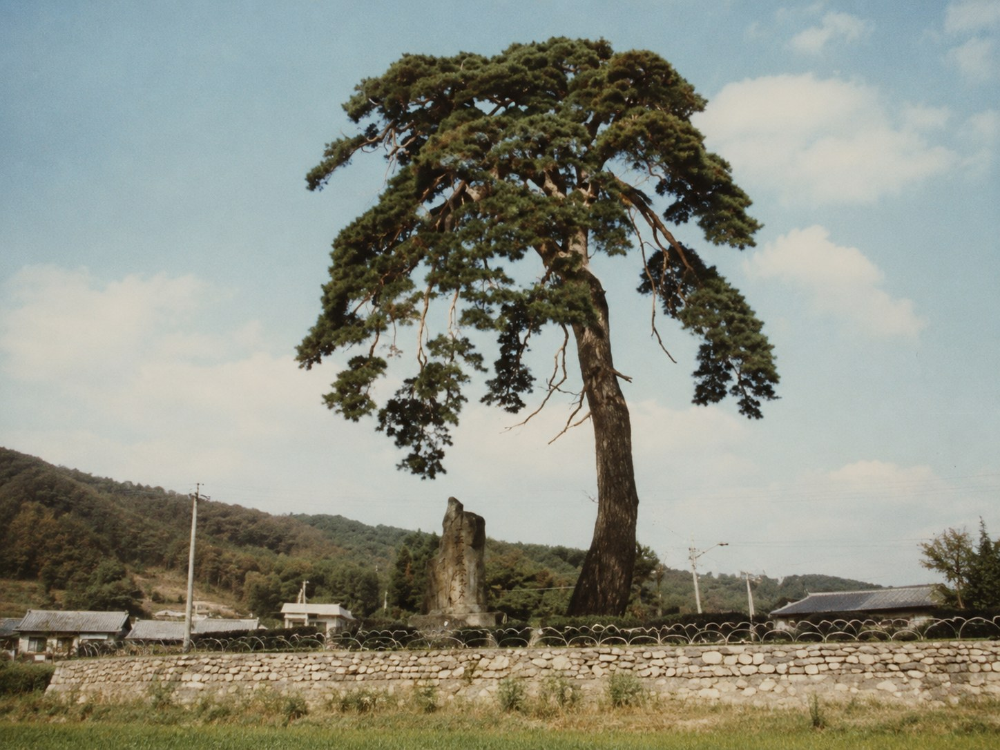
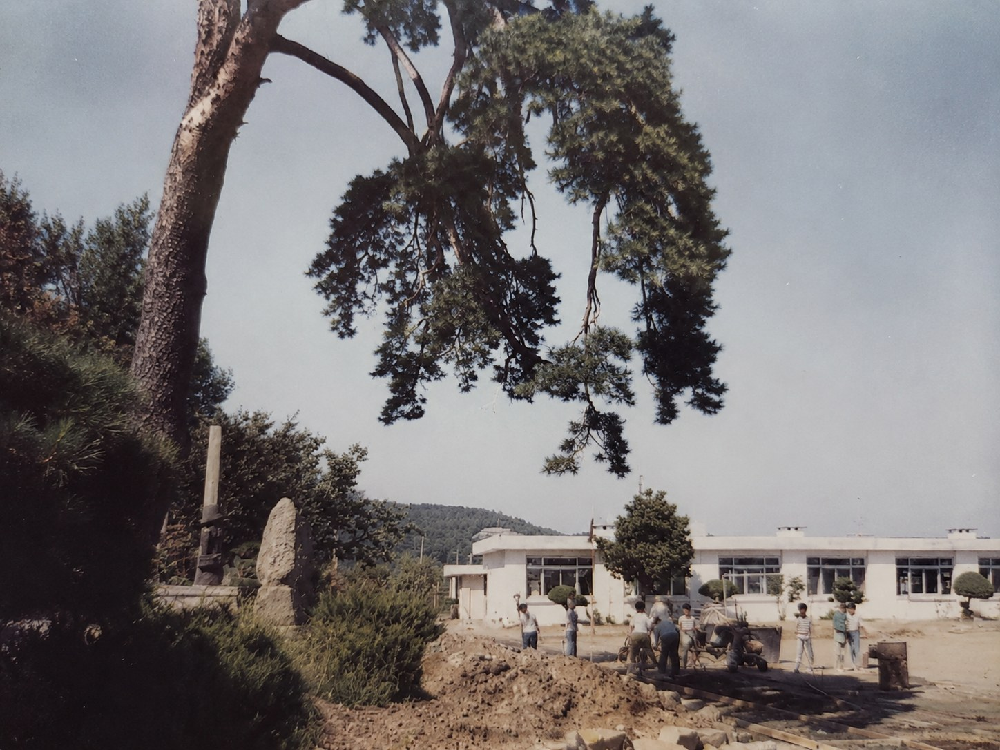
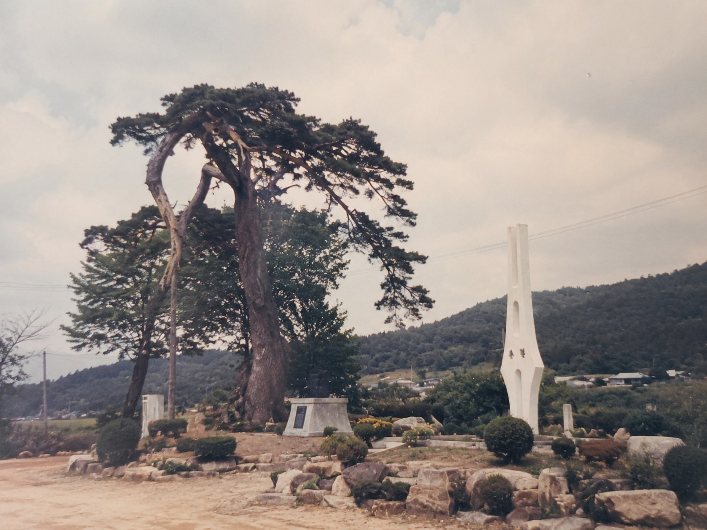

<aside class="myeongpa-document-note">

부채솔은 지금은 사라져서 직접 볼 수 없는 명파의 오래된 소나무입니다. 이 나무는 부채처럼 펼쳐진 독특한 모양 때문에 ‘부채솔’이라 불렸습니다. 자료를 찾아보니 《고성군지》에는 약 300년 전 명파 마을의 부유한 장자인 김유근이 심은 나무로 기록되어 있었고, 1994년 강원일보 기사에서는 약 450년 된 노거송으로 소개되어 있었습니다. 또 명파 주민들의 증언에 따르면, 부채솔은 약 500년 동안 명파를 지켜온 나무였다고 전해집니다.

</aside>

<figure class="myeongpa-document-figure"><figcaption>작품 이미지: 사라진 부채솔을 명파 사람들의 기억 속 상징목으로 다시 세운 그림.</figcaption></figure>

저는 처음 부채솔 이야기를 들었을 때, 단순히 오래된 나무 하나가 사라졌다는 느낌보다는 명파의 한 시대가 같이 사라진 것처럼 느껴졌습니다. 주민들에게 부채솔은 그냥 소나무가 아니었습니다. 아이들이 그 나무에 줄을 묶어 그네를 타고 놀았고, 주민과 관광객들이 그 앞에서 사진을 찍었으며, 명파초등학교 졸업 앨범에도 자주 등장했던 마을의 명물이었습니다. 누군가에게는 어린 시절의 놀이터였고, 누군가에게는 학교 앞 풍경이었고, 또 누군가에게는 명파를 떠올리게 하는 가장 강한 이미지였을 것입니다.

<figure class="myeongpa-document-figure"><figcaption>부채처럼 펼쳐진 수형과 마을의 상징목으로서의 존재감을 재구성한 참고 이미지.</figcaption></figure>

부채솔은 원래 명파초등학교 뒤 논 자리에 있었으나, 이후 명파초등학교 부지로 옮겨졌다고 합니다. 옛 사진을 보면 부채솔은 학교와 마을 풍경 속에 아주 자연스럽게 서 있습니다. 커다란 줄기와 한쪽으로 휘어진 가지, 부채처럼 퍼진 수형은 멀리서 보아도 특별한 존재감을 가지고 있었습니다. 그래서 이 나무는 단순한 자연물이 아니라, 명파 사람들의 생활과 기억을 오래 바라보고 있었던 하나의 상징처럼 느껴졌습니다.

<figure class="myeongpa-document-figure"><figcaption>명파초등학교와 마을 생활 속에 있었던 부채솔의 분위기를 떠올리게 하는 참고 이미지.</figcaption></figure>

특히 흥미로웠던 것은, 부채솔이 ‘애국송’이라고도 불렸다는 점입니다. 나무가 북한 방향과 반대로 휘어 있었다고 전해지는데, 주민들은 이를 두고 “김일성을 싫어해서 반대 방향으로 자랐다”고 이야기했다고 합니다. 접경 마을인 명파에서 이런 이야기는 단순한 농담처럼 들리기도 하지만, 동시에 이 마을이 어떤 역사적 감각 속에서 살아왔는지를 보여주는 말처럼 느껴졌습니다. 나무의 모양 하나에도 마을 사람들은 시대의 이야기를 입혔고, 그 이야기는 부채솔을 더 특별한 나무로 만들었습니다.

하지만 부채솔은 결국 1994년에 고사했습니다. 자료에는 고령과 관리 부족으로 점차 쇠약해졌고, 쓰러져가는 나무를 제대로 관리하지 못한 채 시멘트를 발라 고정하려던 조치가 오히려 고사 원인이 되었다는 주민들의 이야기도 남아 있었습니다. 저는 이 대목을 보며 마음이 아쉬웠습니다. 500년 가까이 마을을 지켜온 나무가 마지막에는 제대로 보호받지 못하고 사라졌다는 사실이, 명파의 사라지는 이야기들과 겹쳐 보였기 때문입니다.

<figure class="myeongpa-document-figure"><figcaption>기념비와 함께 서 있던 오래된 상징목의 인상을 재구성한 참고 이미지.</figcaption></figure>

제가 이 그림을 그릴 때 가장 중요하게 생각한 것은, 부채솔을 단순히 옛 사진처럼 복원하는 것이 아니었습니다. 이미 사라진 나무를 정확하게 다시 그리는 것보다, 부채솔이 명파 사람들에게 어떤 존재였는지를 그리고 싶었습니다. 그래서 그림 속 부채솔은 실제 사진보다 조금 더 상징적인 모습으로 서 있습니다. 넓게 퍼진 가지는 마을을 오래 감싸고 있던 시간을 떠올리게 하고, 부채를 든 인물은 ‘부채솔’이라는 이름과 이 나무를 심었다고 전해지는 옛사람의 이미지를 함께 상징합니다.

그림의 색감은 일부러 오래된 사진처럼 차분하게 잡았습니다. 실제 자료 속 부채솔 사진들은 오래된 필름 사진처럼 색이 바래 있고, 하늘과 나무의 색도 선명하기보다 조금 흐릿하고 아련했습니다. 그래서 그림에서도 강한 색보다 흐릿한 하늘, 어두운 초록, 회색빛 산의 색을 사용했습니다. 이 색감은 부채솔이 지금은 사라졌고, 우리가 그것을 사진과 기억으로만 다시 만날 수 있다는 감각을 담기 위한 것이었습니다.

제게 부채솔은 단순히 명파에 있었던 오래된 소나무가 아닙니다. 그것은 명파 사람들이 함께 놀고, 사진을 찍고, 학교 생활을 기억하고, 마을의 이야기를 붙여온 장소였습니다. 지금은 사라졌지만, 부채솔이라는 이름과 사진, 주민들의 증언 속에는 여전히 명파의 시간이 남아 있습니다.

이 그림은 사라진 나무를 다시 세워보려는 작업입니다. 정확한 복원이 아니라, 명파 사람들의 기억 속에 남아 있는 부채솔의 존재감을 제가 다시 상상해본 그림입니다. 부채처럼 펼쳐진 가지, 오래된 선비의 이미지, 흐릿한 하늘과 산의 색을 통해, 이제는 볼 수 없는 나무가 여전히 마을의 한 장면으로 남아 있기를 바라는 마음을 담았습니다.

