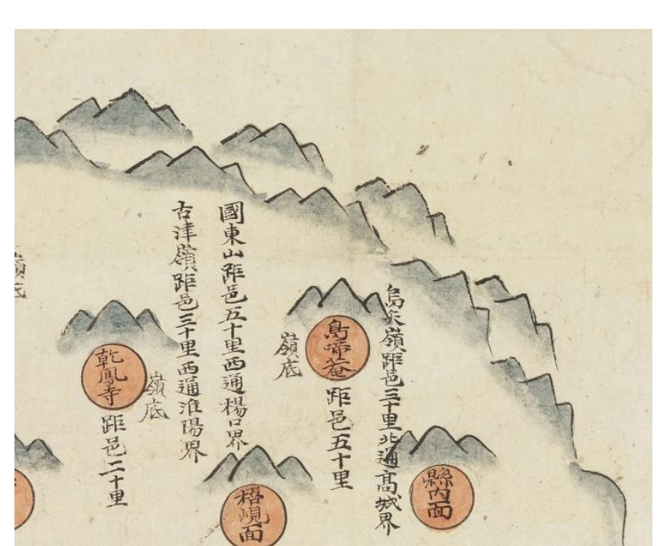
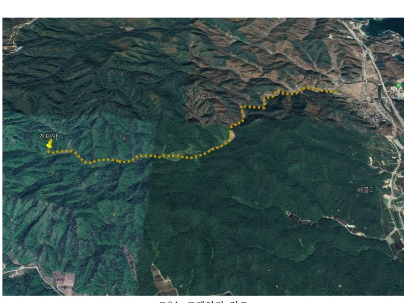
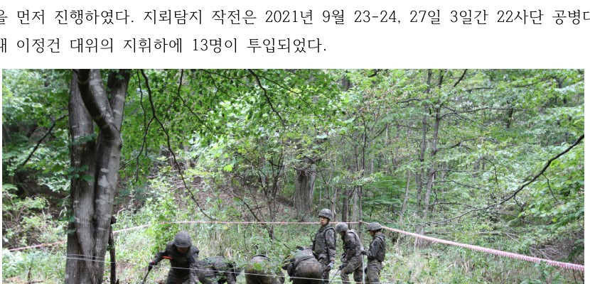
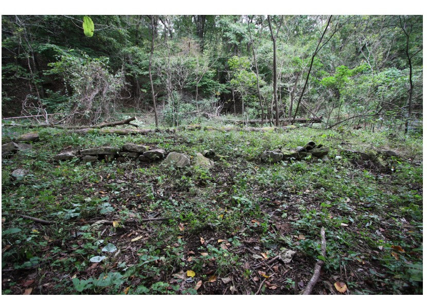

<aside class="myeongpa-document-note">

전문가 관점에서 본 구성 방향 전시적으로 조제암은 ‘유적 설명’보다 ‘자료를 따라가며 보이지 않는 장소를 붙잡는 과정’이 핵심입니다. 관객은 조제암의 세부 연혁보다, 작가가 왜 이 이름을 놓치지 못했는지, 왜 보지 못한 장소를 그림으로 불러오려 했는지를 따라갈 때 더 잘 몰입합니다.

</aside>

<figure class="myeongpa-document-figure"><figcaption>1872년 지방도에 남아 있는 ‘鳥啼菴’의 기록. 조제암은 처음부터 제게 실제 풍경보다 먼저 이름과 자료로 다가왔습니다.</figcaption></figure>

조제암은 제가 직접 가보지 못한 장소입니다. 하지만 명파의 사라진 장소들을 찾는 과정에서, 이 이름은 오래 마음에 남았습니다. 처음에는 그저 명파 안쪽에 있었다는 옛 암자 정도로만 알고 있었지만, 자료를 찾을수록 조제암은 단순한 절터가 아니라 금강산으로 향하던 길 위에 있던 장소라는 것을 알게 되었습니다.

조제암은 건봉사에서 조제암을 거쳐 유점사로 이어지던 순례길의 중간에 있었던 암자로 정리되어 있습니다. 지금은 민통선 안에 있어 쉽게 갈 수 없고, 그래서 오랫동안 정확한 모습도 알기 어려웠던 곳입니다. 저는 이 사실이 이상하게 마음에 걸렸습니다. 마을 안에 있지만 갈 수 없는 장소, 이름은 남아 있지만 모습은 사라진 장소처럼 느껴졌기 때문입니다.

<figure class="myeongpa-document-figure"><figcaption>조제암지 경로. 명파 안쪽에 있지만 쉽게 닿을 수 없는 장소라는 감각이 이 작업의 출발점이 되었습니다.</figcaption></figure>

특히 ‘조제암’이라는 이름이 좋았습니다. 조제암은 ‘새가 우는 암자’라는 뜻을 가지고 있고, 새가 우는 소리를 따라가 절터를 찾았다는 이야기도 전해집니다. 저는 이 이름을 보며, 조제암이 건물보다 먼저 소리로 남아 있는 장소처럼 느껴졌습니다. 숲속 어딘가에서 들리는 새소리, 사라진 길, 그리고 더 이상 쉽게 닿을 수 없는 암자. 그런 이미지가 먼저 떠올랐습니다.

자료를 찾다 보니 조제암은 단순히 시간이 지나 사라진 장소가 아니었습니다. 민통선 안에 있어 접근이 제한되었고, 정밀조사도 지뢰탐지 이후에야 진행될 수 있었습니다. 조사 자료에는 조제암 일대에서 포탄과 수류탄 등이 발견되어 실제 전투가 있었음이 확인되었다고 기록되어 있습니다. 저는 이 대목에서 조제암이 사라진 이유가 단순히 ‘오래되어서’가 아니라, 전쟁과 분단의 시간 속에 묻힌 것이었다는 생각을 하게 되었습니다.

<figure class="myeongpa-document-figure"><figcaption>조제암지 정밀지표조사에 앞서 진행된 지뢰탐지 작전 현황. 이 장소가 전쟁과 분단의 시간 속에 남겨졌음을 보여줍니다.</figcaption></figure>

지금 조제암터에는 완전한 건물이 남아 있지 않습니다. 대신 석축과 초석, 기와편과 자기편 같은 흔적들이 남아 있습니다. 어떤 장소는 사라졌다고 말하지만, 실제로는 완전히 사라진 것이 아니라 조각난 형태로 남아 있는 경우가 있습니다. 조제암도 제게는 그런 장소처럼 느껴졌습니다. 건물은 사라졌지만, 이름과 길과 돌, 그리고 작은 유물 조각들이 여전히 그곳을 증언하고 있었습니다.

<figure class="myeongpa-document-figure"><figcaption>조제암지 상단 평탄지의 건물지 기단과 초석 전경. 완전한 건물은 사라졌지만, 장소의 흔적은 아직 남아 있습니다.</figcaption></figure>

그래서 저는 조제암을 정확하게 복원하려고 그리지 않았습니다. 제가 본 것은 실제 사찰의 모습이 아니라, 자료와 이름, 그리고 명파 안에 남아 있는 보이지 않는 장소의 기운이었습니다. 저는 그 보이지 않는 암자를 그림으로 먼저 불러오고 싶었습니다.

조제암을 찾는 과정은 저에게 명파를 더 깊이 보게 한 시간이었습니다. 처음에는 그림을 그리기 위해 자료를 찾았지만, 어느 순간부터는 사라진 장소를 그냥 지나치고 싶지 않다는 마음이 더 커졌습니다. 누군가 기억하지 않으면 이름만 남고, 이름마저 사라지면 그 장소는 정말 없어질 것 같았습니다.

제게 조제암은 아직 닿지 못한 장소입니다. 하지만 그래서 더 오래 마음에 남은 장소이기도 합니다. 이 그림은 실제로 본 풍경의 기록이라기보다, 자료를 붙잡고 끝까지 찾아가고 싶었던 마음, 그리고 명파 안에 아직 보이지 않는 이야기들이 남아 있다는 믿음을 담은 작업입니다.

자료 출처: 『고성 조제암지 정밀지표조사 보고서』(2021), 명파 마을 자료 정리. QR 관람용으로 일부 내용을 작가의 조사 과정 중심으로 재구성했습니다.

