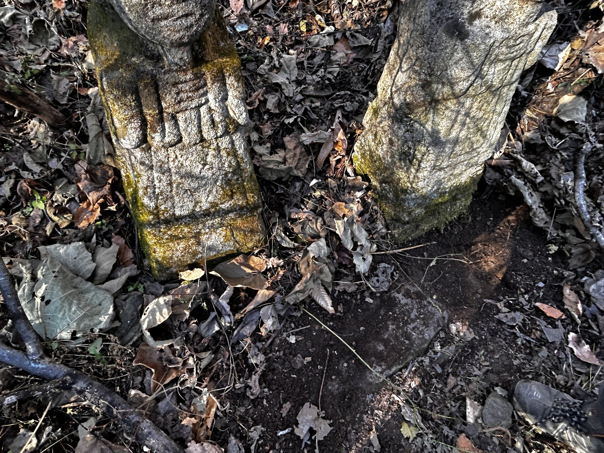

<aside class="myeongpa-document-note">

처음 이 그림을 그릴 때, 저는 문인석의 실물을 직접 확인하지 못했습니다. 명파 안에 오래된 문관석이 있었다는 이야기와 자료를 바탕으로, 마을의 사라진 시간을 지키는 돌 사람을 상상하며 그렸습니다. 그런데 이후 노인회장님과 함께 애끼미와 부호군 황성일 묘 주변을 탐사하며, 문인석으로 보이는 석상 4구 정도를 실제로 발견하게 되었습니다.

</aside>

<figure class="myeongpa-document-figure"><figcaption>애끼미 안쪽으로 들어가며 보이는 숲과 바다 방향. 문인석은 사람의 손길이 거의 닿지 않은 골짜기 안에 남아 있었다.</figcaption></figure>

<h2>명파리 문인석</h2>

명파리 문인석은 제가 처음 그림을 그릴 당시에는 직접 확인하지 못했던 유물이었습니다. 그때 저는 명파 안에 오래된 문관석이 있었다는 이야기와 자료를 바탕으로, 마을 입구 어딘가에 조용히 남아 있는 돌 사람을 상상하며 이 그림을 그렸습니다. 그래서 그림 속 문인석은 실제 유물을 그대로 옮긴 것이라기보다, 명파의 오래된 시간을 지키고 있는 상징 같은 존재에 가까웠습니다.

그림을 그릴 때만 해도 저는 이 돌이 어디에, 어떤 모습으로 남아 있는지 정확히 알지 못했습니다. 다만 명파라는 마을 안에는 아직 제대로 기록되지 않았거나, 사람들에게 잊혀가고 있는 유물과 이야기가 더 있을 것 같다는 생각이 있었습니다. 그래서 이 문인석을 마을의 과거를 묵묵히 바라보는 존재처럼 그리고 싶었습니다.

<figure class="myeongpa-document-figure"><figcaption>애끼미에서 확인한 문인석 2구. 주민들 사이에서는 오랫동안 ‘불상’처럼 불렸다고 한다.</figcaption></figure>

<figure class="myeongpa-document-figure"><figcaption>바다를 바라보는 방향으로 서 있는 듯한 두 석상. 낙엽과 덩굴 사이에 조용히 남아 있었다.</figcaption></figure>

그런데 나중에 노인회장님과 함께 실제로 마을 안쪽을 찾아다니며, 애끼미와 부호군 황성일 묘 주변에서 문인석으로 보이는 석상 4구 정도를 발견하게 되었습니다. 애끼미 안쪽에 있던 석상은 주민들 사이에서 오랫동안 ‘불상’처럼 불리던 것이었지만, 실제로 보니 문관석 형태와 유사했습니다. 특히 남녀 한 쌍처럼 보이는 두 석상이 나란히 바다를 바라보는 방향으로 서 있었던 모습이 인상 깊었습니다.

그 장소는 오랜 시간 사람의 손길이 거의 닿지 않은 골짜기였습니다. 낙엽이 쌓이고 나무와 덩굴이 둘러싼 곳에, 작은 돌 사람들처럼 석상들이 남아 있었습니다. 어떤 석상은 비교적 온전했고, 어떤 석상은 얼굴 부분이 훼손되어 있었습니다. 이 유물들은 별다른 관리 없이 방치된 상태였고, 그래서 더 조용하고 외롭게 느껴졌습니다.

그 석상들을 보았을 때, 저는 조금 이상한 감정을 느꼈습니다. 처음에는 그림으로만 상상했던 존재가, 나중에 실제 숲속에서 나타난 것 같았습니다. 제가 그린 그림이 먼저 있었고, 그 뒤에 실제 유물을 발견한 셈이었습니다. 그래서 이 작품은 저에게 단순한 상상화가 아니라, 명파를 계속 걷고 찾다 보니 뒤늦게 현실과 만나게 된 그림처럼 느껴집니다.

<figure class="myeongpa-document-figure"><figcaption>문인석 하단과 주변 낙엽, 이끼의 질감. 숲속에 방치된 시간이 그대로 남아 있었다.</figcaption></figure>

<h2>그림에서 다시 볼 점</h2>

그림에서는 문인석을 크고 또렷한 존재로 세웠습니다. 실제로 발견한 문인석들은 작고 낮은 석상들이었지만, 제가 그림에서 표현하고 싶었던 것은 크기나 형태보다도 그 존재감이었습니다. 오랜 시간 마을 입구나 묘역을 지키고 있었을 돌 사람, 그러나 어느 순간 잊혀져 숲속에 남게 된 존재. 저는 그 조용한 시간을 그림 속 문인석의 표정과 먹빛 분위기로 담고 싶었습니다.

그림 안의 세로 글씨는 유물의 설명이면서 동시에 명파에 대한 기록처럼 보이도록 넣었습니다. 명파 안에는 이전에 누군가 세웠던 돌이 있고, 그 돌은 사라진 줄 알았지만 사실 어딘가에 남아 있었습니다. 저는 이 문인석을 통해 명파의 과거가 완전히 사라진 것이 아니라, 아직도 숲과 골짜기 속에서 조용히 기다리고 있다는 느낌을 받았습니다.

제게 명파리 문인석은 단순한 유물이 아닙니다. 처음에는 자료와 상상으로 그렸고, 나중에는 실제 탐사에서 발견하게 된 대상입니다. 그래서 이 작품은 제가 명파를 조사하며 경험한 가장 이상한 순간 중 하나를 담고 있습니다. 그림이 먼저 길을 열었고, 그 뒤에 실제 장소와 유물이 제 앞에 나타난 것처럼 느껴졌습니다.

이 그림은 명파의 문인석을 정확하게 복원한 그림은 아닙니다. 오히려 아직 제대로 기록되지 않은 유물을 바라보는 제 마음에 가깝습니다. 잊힌 돌, 바다를 바라보는 작은 석상들, 방치된 묘역, 그리고 언젠가 다시 조사되고 보존되기를 바라는 마음. 이 모든 것을 하나의 조용한 문관석 이미지로 담아보려 한 작업입니다.

OFFITA · 명파 X경

