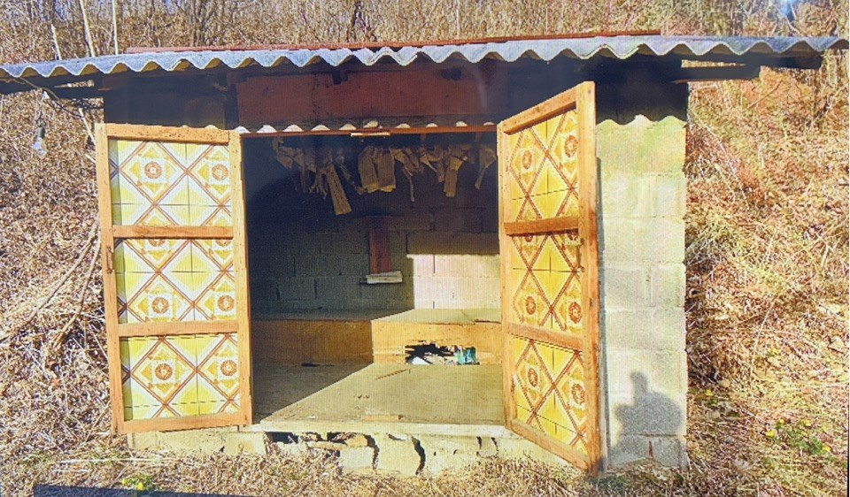
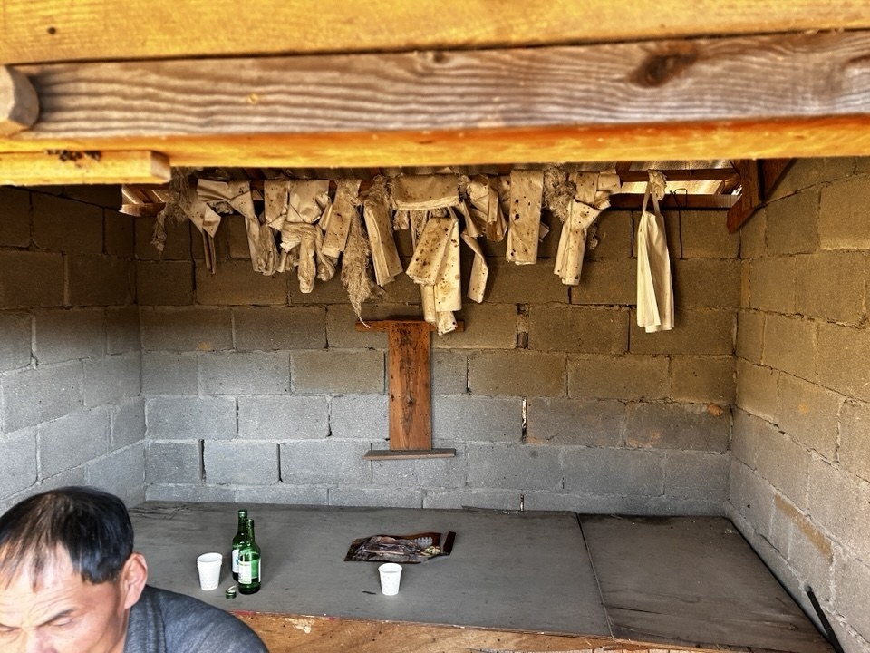
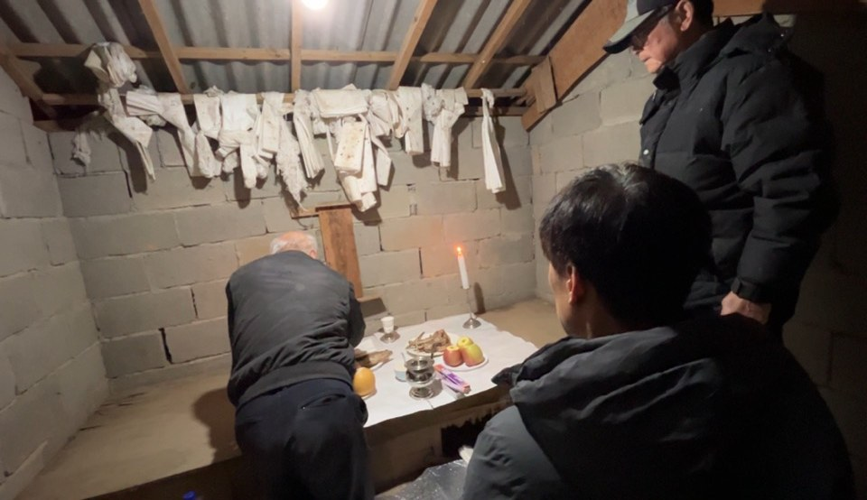
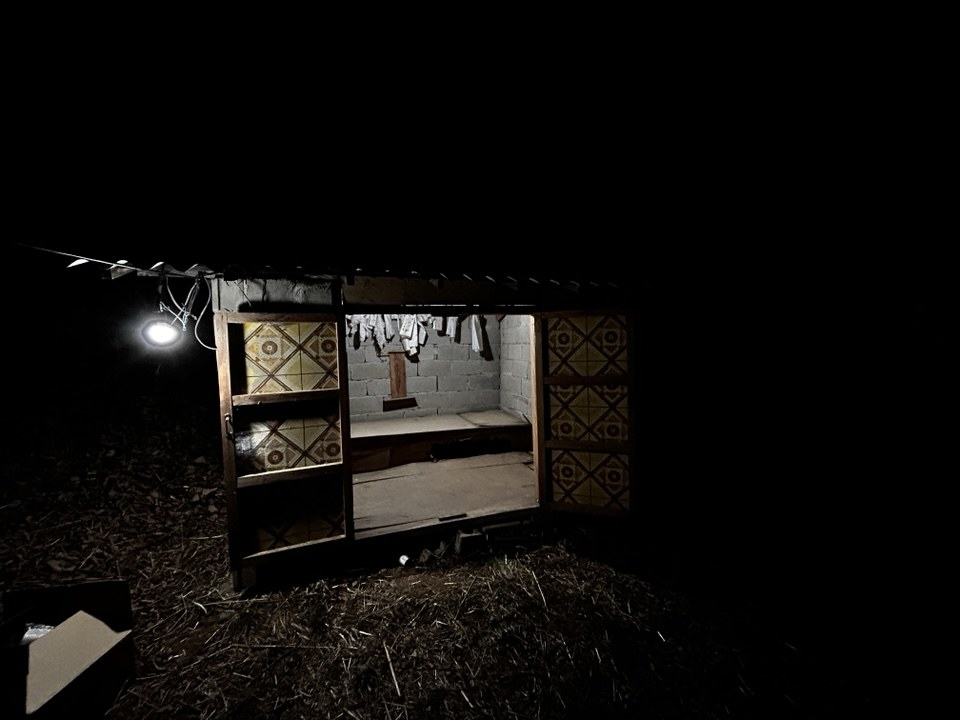

<aside class="myeongpa-document-note">

안골 서낭당은 명파 마을에서 해마다 제사를 지내며 마을의 안녕을 기원하는 장소입니다. 이 글은 서낭당의 형식만 설명하기보다, 제가 카메라맨으로 동행하며 마을의 의례 안쪽으로 들어갔던 경험을 중심으로 기록한 글입니다.

</aside>

<figure class="myeongpa-document-figure"><figcaption>안골 서낭당의 외부. 평소에는 조용히 닫혀 있지만, 제사 때가 되면 마을의 중요한 의례 공간이 된다.</figcaption></figure>

안골 서낭당은 명파 마을에서 해마다 제사를 지내는 장소입니다. 평소에는 조용히 닫혀 있는 작은 건물처럼 보이지만, 제사 때가 되면 마을의 어른들이 모여 마을의 안녕을 기원하는 중요한 장소가 됩니다.

처음 안골 서낭당 이야기를 들었을 때, 저는 이곳이 단순히 오래된 제사 장소라고만 생각했습니다. 그런데 준비 과정과 제사 당일을 함께 따라가 보니, 이 장소는 생각보다 훨씬 더 마을 안쪽에 있는 공간이었습니다. 누구나 쉽게 참여하는 행사가 아니라, 마을 안에서 오랫동안 이어져 온 규칙과 조심스러움이 있는 의례였기 때문입니다.

안골 서낭당 제사는 남성들만 참여할 수 있다고 들었습니다. 또 제사 날짜를 정할 때도 여러 조건이 있었습니다. 특정 기간에는 장례식에 가지 않아야 하고, 마을 안에 돌아가신 분이 없어야 제사를 지낼 수 있다고 했습니다. 처음에는 이런 규칙들이 낯설게 느껴졌지만, 시간이 지나면서 이것이 단순한 절차가 아니라 마을 사람들이 제사를 얼마나 조심스럽고 중요하게 여기는지를 보여주는 방식처럼 느껴졌습니다.

제사 일주일 전에는 서낭당 주변을 정비했습니다. 동네 아저씨들과 함께 잡초를 베고, 주변을 정리하고, 제사를 준비할 공간을 만들었습니다. 평소에는 그냥 지나칠 수 있는 작은 건물이었지만, 사람들이 손을 대고 길을 정리하고 안을 살피기 시작하자 그곳은 점점 의례의 장소처럼 변해갔습니다.

<figure class="myeongpa-document-figure"><figcaption>서낭당 안쪽에 남아 있는 제사 공간과 용품들. 낡은 서랍과 제사 도구는 마을의 시간이 쌓인 흔적처럼 보인다.</figcaption></figure>

제사 당일에는 새벽에 출발했습니다. 아직 어두운 시간에 마을 아저씨들과 함께 안골 서낭당으로 향했고, 저는 카메라맨으로 동행했습니다. 카메라를 들고 따라가던 그 시간은 이상하게 특별하게 느껴졌습니다. 저는 단순히 구경하러 간 것이 아니라, 마을 사람들이 오래 지켜온 일을 기록하는 역할로 함께하고 있었습니다.

서낭당 안에는 낡은 서랍이 있었고, 그 안에는 제사에 쓰이는 물건들이 보관되어 있었습니다. 오래된 건물 안에 제사 용품들이 남아 있는 모습은 인상적이었습니다. 평소에는 보이지 않던 마을의 시간이 그 작은 서랍 안에 들어 있는 것 같았습니다.

<figure class="myeongpa-document-figure"><figcaption>제사 당일 내부 풍경. 마을 어른들이 함께 절하고 의례를 이어가는 장면을 카메라로 기록했다.</figcaption></figure>

제사가 시작되자 한 분이 글을 읽었고, 이장님이 대표로 앞으로 나와 의례를 진행했습니다. 이장님이 절을 하면 뒤에 계신 어른들도 함께 절을 했습니다. 저는 그 장면을 카메라로 찍으며, 이 제사가 단순히 형식적인 행사가 아니라 마을 사람들이 같은 방향을 바라보는 시간이라는 생각을 했습니다.

<figure class="myeongpa-document-figure"><figcaption>새벽 어둠 속의 서낭당. 어둠과 불빛 사이에서 제사를 준비하는 분위기가 드러난다.</figcaption></figure>

그날 저는 아저씨들에게 조금 다르게 받아들여진 것 같았습니다. 정확히 말로 설명하기는 어렵지만, 그 새벽에 함께 걸어가고, 카메라를 들고 제사를 기록하고, 끝까지 자리를 함께하면서 처음으로 진정한 명파의 남성으로 인정받은 것 같은 기분이 들었습니다. 외부에서 온 예술가가 아니라, 마을 안쪽의 일을 함께 맡은 사람처럼 느껴졌습니다.

제사가 끝난 뒤에는 함께 풍성한 식사를 했습니다. 새벽의 긴장감과 엄숙함이 지나가고, 사람들은 다시 웃고 이야기했습니다. 조심스럽게 제사를 준비하고, 함께 절을 하고, 마지막에는 밥을 나누어 먹는 과정 전체가 하나의 공동체처럼 느껴졌습니다.

제게 안골 서낭당은 단순히 제사를 지내는 건물이 아닙니다. 이곳은 명파 사람들이 마을의 안녕을 빌고, 오래된 규칙을 지키고, 서로의 자리를 확인하는 장소입니다. 동시에 제게는 명파 바깥에서 들어온 제가 조금 더 마을 안쪽으로 들어가게 된 장소이기도 합니다.

이 글과 사진을 통해 보여주고 싶은 것은 제사의 신비로움만은 아닙니다. 오히려 그 새벽의 공기, 낡은 서랍 속 제사 용품, 어른들이 함께 절하던 모습, 그리고 제사 뒤에 나누어 먹던 식사까지 포함한 하나의 시간입니다. 안골 서낭당은 명파의 오래된 믿음과 지금 살아 있는 공동체가 만나는 장소였습니다.

<aside class="myeongpa-document-note">

다시 볼 점: 안골 서낭당은 단순한 건물이 아니라, 명파 사람들이 마을의 안녕을 빌고 서로의 자리를 확인하는 의례의 장소입니다. 사진 속 문, 낡은 서랍, 새벽의 불빛, 함께 절하는 장면을 보며 이 장소가 가진 공동체의 시간을 함께 읽어볼 수 있습니다.

</aside>

