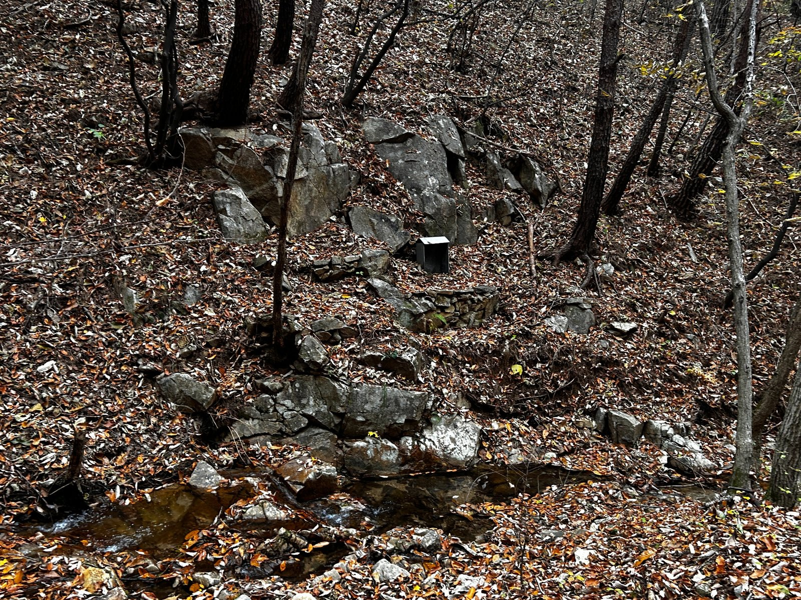
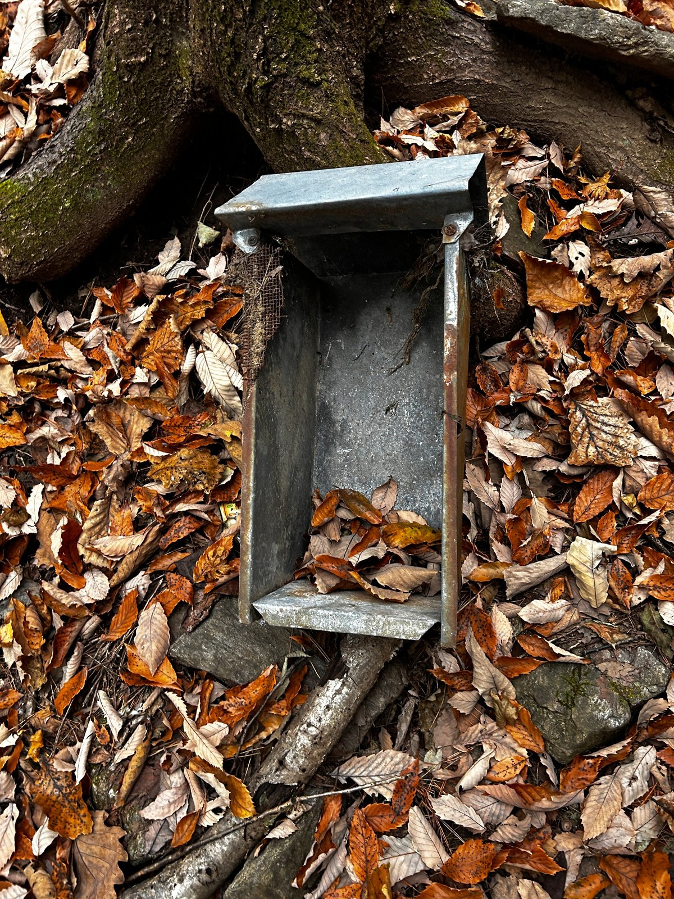
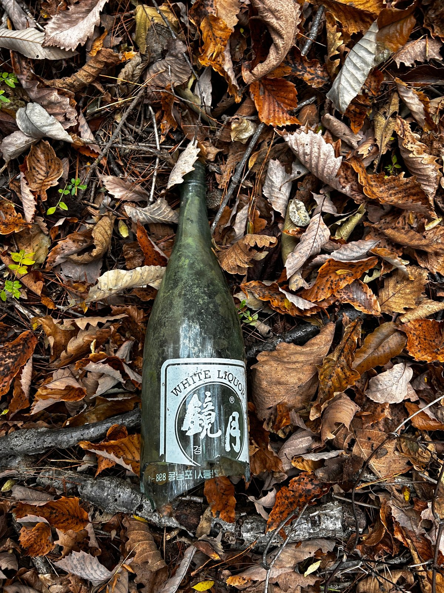

<aside class="myeongpa-document-note">

쌍학골은 명파 마을 남쪽에 있는 골짜기입니다. 이름은 조선 말엽, 두 마리 학이 무덤에서 날아올랐다는 이야기에서 유래했다고 전해집니다. 마을 주민 대부분은 쌍학골이 어디인지 알고 계셨지만, 이 전설까지 자세히 아는 분은 많지 않았습니다.

</aside>

<figure class="myeongpa-document-figure"><figcaption>쌍학골 안쪽에서 만난 개울과 웅덩이. 무섭게만 들었던 장소 안에도 깊은 고요함과 평안한 자연이 있었다.</figcaption></figure>

처음 쌍학골 이야기를 들었을 때, 이곳은 다소 무서운 장소처럼 느껴졌습니다. 주민들 사이에서는 귀신이 나오는 곳, 재수 없는 곳처럼 이야기되기도 했고, 예전에는 한 아이가 실종된 뒤 쌍학골에서 발견되었다는 이야기도 전해졌습니다. 길목에 무덤이 많고, 과거 무당이 제사를 지내던 곳도 있었습니다.

하지만 실제로 쌍학골을 걸어보았을 때 제가 느낀 감정은 조금 달랐습니다. 물론 낮에도 숲이 어둡고, 사람의 발길이 거의 끊긴 깊은 골짜기라 긴장되는 분위기가 있었습니다. 그런데 동시에 그곳에는 이상하리만큼 고요하고 평안한 자연이 있었습니다. 중앙으로는 개울이 흐르고, 중간중간 웅덩이와 작은 계곡이 이어져 있었습니다. 바람에 나무가 흔들리는 소리와 물 흐르는 소리가 함께 들렸고, 저는 그곳을 걸으며 이상하게 마음이 차분해지는 경험을 했습니다.

<figure class="myeongpa-document-figure"><figcaption>쌍학골 안쪽의 숲과 바위, 오래된 흔적들. 아름다운 자연 속에 설명하기 어려운 긴장감이 함께 느껴졌다.</figcaption></figure>

쌍학골 안에서는 여러 흔적도 발견했습니다. 제사를 지낸 것으로 추정되는 자리, 철제 상자, 탄 양초와 종이, 그리고 지금은 단종된 오래된 경월 소주병도 있었습니다. 이것들이 정확히 무엇을 의미하는지는 단정할 수 없지만, 적어도 이곳이 단순한 산골짜기만은 아니었다는 생각이 들었습니다. 누군가 이곳을 찾아왔고, 무언가를 했으며, 그 흔적이 아직 남아 있었습니다.

<h2>현장에서 발견한 흔적</h2>

<figure class="myeongpa-document-figure"><figcaption>제사를 지낸 흔적으로 추정되는 자리에서 발견한 철제 상자. 정확한 쓰임은 단정할 수 없지만, 장소에 남은 행위의 흔적처럼 느껴졌다.</figcaption></figure>

<figure class="myeongpa-document-figure"><figcaption>낙엽 속에서 발견한 오래된 경월 소주병. 쌍학골에 쌓인 시간과 사람의 흔적을 보여주는 작은 증거처럼 느껴졌다.</figcaption></figure>

<h2>그림에서 다시 볼 점</h2>

그림에서는 이런 복합적인 느낌을 담고 싶었습니다. 두 마리 학은 쌍학골이라는 이름의 전설을 상징합니다. 가운데의 작은 제단과 촛불은 현장에서 보았던 제사의 흔적을 떠올리며 넣었습니다. 오른쪽의 오래된 소주병은 답사 중 발견한 경월 소주병에서 가져온 이미지입니다. 아래의 연두빛 물은 실제로 쌍학골을 걸으며 보았던 개울과 웅덩이의 평안한 인상을 바탕으로 표현했습니다.

제게 쌍학골은 단순히 무서운 장소가 아니었습니다. 오히려 아름다움과 두려움, 자연과 제사의 흔적, 전설과 실제 답사가 함께 남아 있는 이상한 장소였습니다. 이 그림은 제가 쌍학골을 걸으며 느꼈던 묘한 평안과 긴장감, 그리고 아직 다 밝혀지지 않은 이야기를 한 화면에 담아보려 한 작업입니다.

명파 X경 — 보이지 않는 명파

