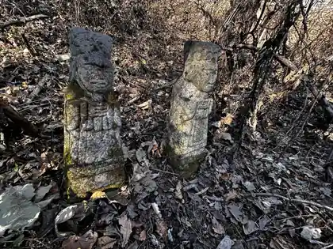
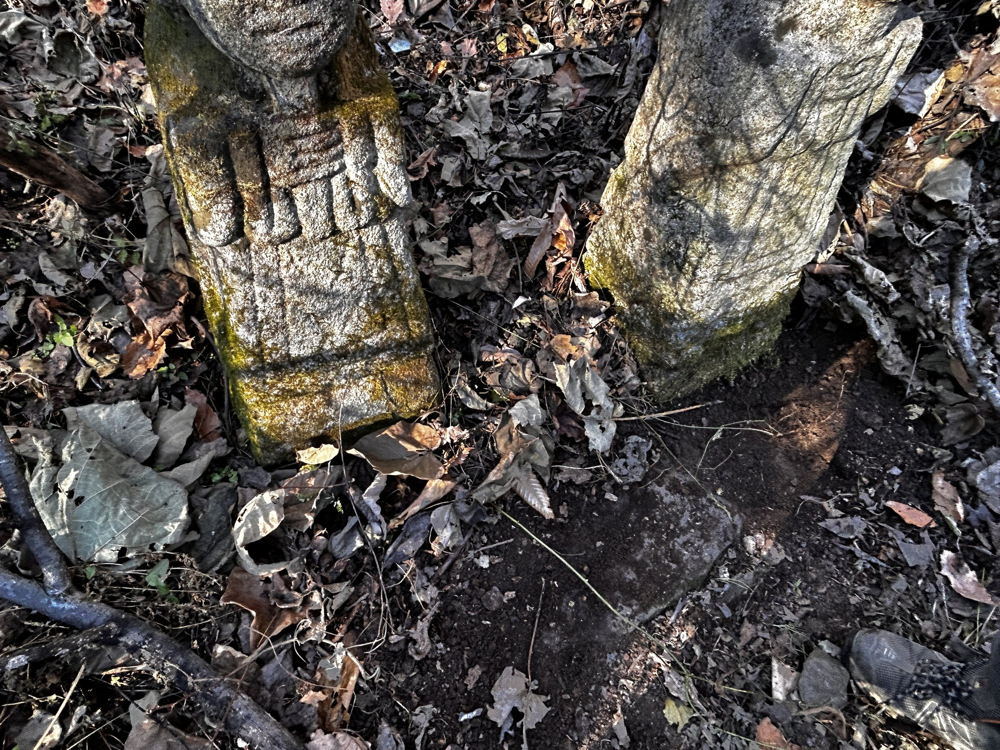
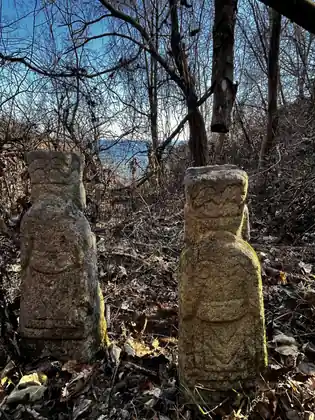
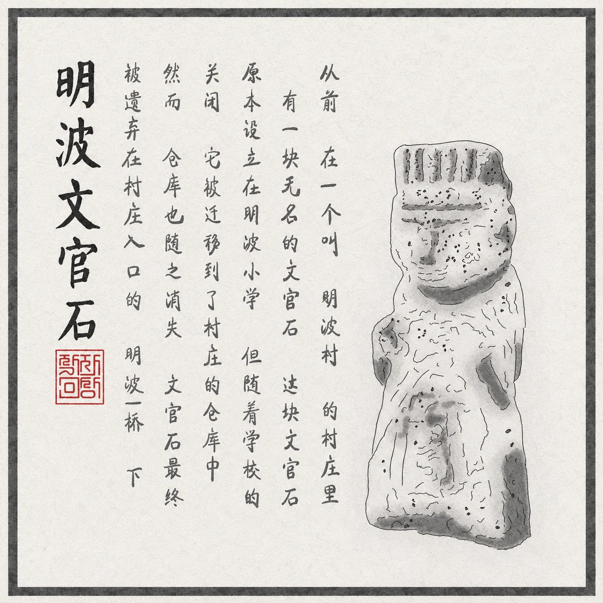

  
MYEONGPA FIELD RESEARCH · LOCAL CULTURE &amp; HERITAGE ARCHIVE

  

    
RESEARCH &amp; DOCUMENTATION<strong>OFFITA (이현석)</strong>

    
PLACE<strong>강원특별자치도 고성군 명파리 일대</strong>

    
METHOD<strong>주민 구술 · 현장탐사 · 사진기록 · 금석문 조사 · 족보 조사</strong>

  

  
명파 지역조사 기간: 2024.06—10 (기존 아카이브 기준). 개별 석상 조사일은 원자료에 미기재. 웹 정리·게시: 2026.11.25. · 현장 확인 및 기초조사 기록, 추가 검증 필요.

<figure><figcaption>FIELD PHOTO · OFFITA ARCHIVE애끼미에서 현장 확인한 석상 2구. 기존 명파 현장기록 사진.</figcaption></figure>

  
FIELD SITES<strong>2개 조사 장소</strong>

  
STONE FIGURES<strong>석상 4구 현장 확인</strong>

  
DOCUMENTS<strong>기초 조사자료 2종 · 총 28쪽</strong>

<nav class="research-index" aria-label="상세 조사기록 목차">

RESEARCH INDEX

<a href="#background">01<strong>조사 배경</strong><em>주민 구술과 현장 확인</em></a>
<a href="#field">02<strong>석상 현장조사</strong><em>애끼미 · 황성일 묘</em></a>
<a href="#epigraphy">03<strong>금석문 조사</strong><em>비문과 기존 기록의 비교</em></a>
<a href="#genealogy">04<strong>족보 조사</strong><em>가계 및 인물 정보</em></a>
<a href="#interpretation">05<strong>문화적 가치</strong><em>역사문화적 고찰</em></a>
<a href="#follow-up">06<strong>후속 조사</strong><em>고성문화원 정밀조사 요청</em></a>
<a href="#art">07<strong>예술적 표현</strong><em>조사와 창작의 관계</em></a>
<a href="#archive">08<strong>자료 아카이브</strong><em>조사자료 및 출처</em></a>
</nav>

01 · RESIDENT TESTIMONY &amp; RESEARCH BACKGROUND

## 주민의 기억에서 시작된 조사

처음 명파리 문인석을 그림으로 그릴 때만 해도 저는 이 석상이 어디에, 어떤 모습으로 남아 있는지 정확히 알지 못했습니다. 당시 제가 참고했던 자료는 1990년에 발간된 『고성군지』에 실린 사진이었습니다.

문인석 사진을 들고 마을 어르신들께 여쭤본 결과, 일부 어르신들께서 이 석상에 대해 알고 계셨으며, 과거 마을에서 기도를 드리던 ‘불상’이라고 말씀해 주셨습니다.

예술 프로젝트가 끝난 뒤에도 마을에 남아 지내던 중, 애끼미라는 지역에서 이 석상을 보았다는 주민의 이야기를 듣게 되었습니다. 이후 노인회장님과 함께 실제 현장을 찾아다니며 문인석으로 보이는 석상 2구를 확인할 수 있었습니다.

이 일을 계기로 주민들의 이야기를 바탕으로 마을의 문화자원을 더욱 적극적으로 조사하게 되었으며, 부호군 황성일 묘에서도 유사한 형태의 석상 2구를 추가로 확인했습니다.

이번 기록은 이 과정에서 확보한 현장사진, 주민의 이야기, 관련 문헌과 금석문, 족보 조사자료를 정리한 것입니다.

02 · FIELD SURVEY &amp; PHOTOGRAPHIC DOCUMENTATION

## 명파리 석상 4구 현장조사

### A. 애끼미 석상 2구

애끼미에 있는 이 조형물은 주민들 사이에서 ‘불상’이라 불리던 석상입니다. 실제로 확인해 보니 불상보다는 문관석의 형태와 유사했으며, 마치 남녀 한 쌍처럼 보이는 두 석상이 나란히 바다를 바라보는 방향으로 세워져 있었습니다.

해당 장소는 사람의 손길이 거의 닿지 않은 골짜기였습니다. 석상 주변에는 낙엽과 나무, 덩굴이 뒤덮여 있었으나, 두 석상은 육안으로 확인한 범위에서 비교적 온전한 형태를 유지하고 있었습니다.

석상의 정면과 후면, 상단과 하단의 형태, 조각된 부분 및 주변 환경을 사진으로 기록했습니다.

<figure><figcaption>FIELD PHOTO · OFFITA ARCHIVE석상 두 구의 얼굴과 전면 조각 형태.</figcaption></figure>
<figure><figcaption>FIELD PHOTO · OFFITA ARCHIVE두 석상의 후면과 주변 환경.</figcaption></figure>
<figure><figcaption>FIELD PHOTO · OFFITA ARCHIVE석상의 하단 및 주변 보존환경.</figcaption></figure>
<figure><figcaption>FIELD PHOTO · OFFITA ARCHIVE기존 명파의 유산에 수록된 추가 관찰 사진.</figcaption></figure>

두 석상의 정확한 성격과 조성 시기, 본래의 설치 목적은 추가적인 조사가 필요합니다. 남녀 한 쌍이라는 표현 또한 현장에서 받은 인상에 따른 것으로, 역사적으로 확인된 사실은 아닙니다.

### B. 부호군 황성일 묘의 석상 2구

더불어 부호군 황성일의 묘도 함께 확인하였습니다. 묘역에는 애끼미에서 확인한 문관석과 유사한 형태의 석상 두 구가 남아 있었습니다.

이 가운데 하나는 얼굴 부분의 훼손과 검게 변색된 모습이 관찰되었으며, 다른 하나는 비교적 온전한 형태를 유지하고 있었습니다.

석상뿐 아니라 묘역에 남아 있는 석물과 비문, 주변의 보존 상태도 함께 사진으로 기록했습니다.

조사 당시 묘역 주변에는 잡목과 풀이 무성했으며, 지속적인 관리가 이루어지고 있는지 확인하기 어려운 상태였습니다.

이후 관련 자료를 검토하는 과정에서 고성문화원의 『금석문 조사 보고서』에도 부호군 황성일 묘와 문인석 2기, 주변 석물에 관한 기존 조사기록이 있음을 확인했습니다.

이번 현장조사는 주민의 이야기를 단서로 해당 장소를 직접 확인하고, 조사 당시의 상태를 기록하며, 기존 문헌과 비교할 수 있는 자료를 확보했다는 점에서 의미가 있습니다.

FIELD RECORD · 「명파리 문인석 4구 자료」 2~10쪽(애끼미), 11~21쪽(황성일 묘). 신규 원본 사진의 공개 범위는 확인 후 확장합니다.

03 · EPIGRAPHY &amp; DOCUMENTARY RESEARCH

## 부호군 황성일 묘와 금석문 조사

### 기존 금석문 조사자료

부호군 황성일 묘에 남아 있는 석물의 문자를 확인하기 위해 고성문화원에서 발행한 『금석문 조사 보고서』를 참고하였습니다.

해당 보고서에는 황성일 묘의 상석 전면과 오른쪽 측면, 왼쪽 측면에 새겨진 한문과 묘역에 관한 조사내용이 수록되어 있습니다.

현장에서 확보한 비문 사진과 기존 보고서의 한문 기록을 비교하며, 문자 판독과 해석에 관한 추가 조사 가능성을 검토했습니다.

### 기존 기록과 실제 비문의 비교

기존 금석문 조사자료와 실제 석물의 이미지를 비교하는 과정에서 일부 문자의 판독이 서로 다를 가능성이 있다고 판단했습니다.

특히 황성일의 아들 이름으로 기록된 한자에 주목했습니다. 당시 저는 비문의 글자가 ‘蓍國’으로 보인다고 판단하였고, 이를 단서로 관련 족보를 찾아보았습니다.

다만 비문의 마모와 사진의 명암, 기존 판독자료 및 전사본 사이의 차이가 존재하므로, 현재 단계에서 정확한 문자를 확정할 수는 없습니다.

기존 조사자 전사<strong>耆國</strong>

기존 기록 내 다른 표기<strong>著國</strong>

현장사진 판독 가설<strong>蓍國</strong>

세 표기는 당시 조사자료에서 비교한 문자 및 판독 가설입니다. 어느 표기가 원 비문의 정확한 문자에 해당하는지는 확정하지 않았습니다.

### 비문에 관한 잠정적 해석

조사 당시에는 비문 사진과 기존 한문 기록에서 서로 다르게 보이는 부분을 검토한 뒤, ChatGPT를 활용하여 한문 내용을 잠정적으로 해석하였습니다.

당시 작성한 해석은 상석의 내용을 이해하고 추가 조사 방향을 설정하기 위한 기초자료였습니다. 전문적인 한문 번역이나 검증이 완료된 금석문 해독 결과는 아닙니다.

**상석 전면**

황성일의 이름과 가계, 가족의 묘에 관한 기록, 후손들이 묘를 관리하고 제사를 이어가는 데 필요한 토지와 관련된 내용이 포함된 것으로 보았습니다.

**상석 오른쪽 측면**

토지의 위치와 규모, 주변 지형 및 경계, 가족의 기일과 관련된 기록이 포함되어 있을 가능성이 있다고 보았습니다.

**상석 왼쪽 측면**

후손들이 조상의 묘와 관련된 토지를 함부로 처분하지 않고 선조의 뜻을 이어가도록 당부하는 내용으로 해석하였습니다.

당시 조사에서 주목한 것은 이 기록이 단순히 황성일이라는 인물에 관한 정보뿐만 아니라, 후손들의 묘지 관리와 제례, 토지의 이용에 관한 내용을 담고 있을 가능성이 있다는 점입니다.

비문의 정확한 판독과 해석, 토지 단위, 지명 및 기일의 확인은 향후 전문적인 검토가 필요합니다.

<a class="research-visual-link" href="https://goseongcul.or.kr/wp-content/uploads/2025/05/%EA%B8%88%EC%84%9D%EB%AC%B8%EC%A1%B0%EC%82%AC%EB%B3%B4%EA%B3%A0%EC%84%9C.pdf" target="_blank" rel="noopener noreferrer">REFERENCE · 2021<strong>고성문화원 금석문 조사 보고서</strong><em>공식 원문 312~316쪽 ↗</em></a>

04 · GENEALOGICAL &amp; HISTORICAL RESEARCH

## 평해 황씨 족보 및 인물 조사

### 황씨 족보 조사

비문에 나타난 부호군 황성일의 가계를 근거로 황씨 족보를 조사하였습니다.

당시 조사에서는 다음 세 가지 정보를 주요 단서로 활용했습니다.

- 이름은 성일(聖一).
- 양무공(襄武公) 황희석(黃希碩)의 후손.
- 아들의 이름은 시국(蓍國)일 가능성.

위 내용과 부합하는 인물을 족보에서 찾아본 결과, 평해 황씨 18세손 황성일에 관한 기록을 확인할 수 있었습니다.

해당 기록은 비문에서 확인한 인물과 족보에 나타나는 인물 사이의 연관성을 검토하기 위한 자료로 활용했습니다.

### 족보에 기록된 황성일

당시 참고한 족보에는 다음과 같은 한문이 기록되어 있었습니다.

> 通政大夫僉知中樞府事忌十二月十五日
>
> 配淑夫人全州李氏父吉晟墓杆城楮津壬坐

이 기록에는 통정대부 첨지중추부사라는 관직 관련 표기와 12월 15일의 기일, 배위인 숙부인 전주 이씨 및 그 부친 이길성(吉晟)에 관한 내용이 나타납니다. 또한 간성 저진의 묘에 관한 기록이 포함되어 있습니다.

묘역의 비문과 족보에 나타나는 이름, 가족관계 및 묘에 관한 기록이 어떠한 연관성을 갖는지 확인하는 것이 당시 조사의 주요 목적이었습니다.

### 부호군과 첨지중추부사

부호군(副護軍)은 조선시대 종4품에 해당하는 군직이며, 통정대부(通政大夫)는 정3품 당상관에 해당하는 품계입니다. 첨지중추부사(僉知中樞府事) 또한 정3품 관직에 해당합니다.

묘표에 나타나는 부호군이라는 명칭과 족보의 통정대부 첨지중추부사라는 기록을 바탕으로 황성일의 관직과 생애를 추가로 연구할 필요가 있다고 판단했습니다.

다만 두 기록만으로 실제 승진 과정이나 구체적인 관직 수행 내용, 생몰연대를 확정할 수는 없습니다.

조사 당시에는 족보의 세대 관계 등을 근거로 황성일이 조선 중기 이후, 특히 17~18세기에 활동했을 가능성을 검토하였습니다. 정확한 활동 시기는 관련 문헌을 통한 추가 확인이 필요합니다.

GENEALOGY · 당시 열람 화면에 표시된 병진대동보(1976), 충경공파보(2001). 원본 대조와 이미지 이용권한 확인 필요.

05 · HISTORICAL &amp; CULTURAL INTERPRETATION

## 부호군 황성일 묘의 역사적·문화적 가치

### 명파의 역사적 인물에 관한 연구 가능성

부호군 황성일의 묘와 관련 기록은 명파와 고성 지역의 역사적 인물을 조사할 수 있는 하나의 단서라고 생각합니다.

비문과 족보에 나타난 관직 및 가계에 관한 정보를 바탕으로 향후 『조선왕조실록』, 『승정원일기』, 『비변사등록』 등 조선시대 관련 기록을 추가로 검토한다면 황성일이라는 인물의 생애와 지역의 역사적 관계를 보다 구체적으로 연구할 수 있을 것입니다.

이를 통해 명파와 고성 지역의 역사적 인물 및 장소에 관한 기록을 보완할 가능성이 있다고 생각합니다.

### 상석과 비문의 문화적 가치

제가 당시 해석한 비문의 내용에서는 후손들이 조상의 뜻을 따르고 묘지 관리를 충실히 이어가도록 당부하는 부분이 인상적이었습니다.

특히 토지를 함부로 처분하지 않고 조상의 묘와 제사를 지속적으로 관리하도록 한 것으로 보이는 내용은, 조선시대의 가족관계와 제례문화, 조상에 대한 인식 및 재산 관리의 관계를 살펴볼 수 있는 자료가 될 수 있다고 생각했습니다.

묘지와 제사에 필요한 토지를 마련하고 이를 통해 지속적인 관리를 도모했다는 해석이 확인된다면, 당시 지역사회의 농경생활과 유산 관리 방식에 관한 연구에도 활용할 수 있을 것입니다.

이러한 관점에서 황성일 묘에 남아 있는 석물과 비문은 한 인물의 묘에 관한 기록을 넘어, 당시 사람들의 생활과 가족문화, 지역의 역사적 환경을 살펴볼 수 있는 자료가 될 가능성이 있습니다.

물론 이러한 역사적·문화적 가치에 관한 판단은 정확한 금석문 해석과 추가적인 전문조사를 전제로 합니다.

06 · CULTURAL PRESERVATION &amp; FOLLOW-UP RESEARCH

## 고성문화원 정밀조사 요청

현장조사 과정에서 확인한 석상과 관련 자료에 대해 고성문화원에 정밀조사를 요청드렸습니다.

당시 마을 주민과 문화원 관계자가 함께 현장을 살펴보는 과정에서 석상의 조성 시기와 보존 상태에 관한 의견을 들을 수 있었습니다.

문화원 관계자는 석상의 형태를 고려할 때 고려 후기에서 조선 중기에 조성되었을 가능성에 관한 의견을 제시했으며, 역사·문화적 차원에서 정밀조사와 가치 평가가 필요하다고 말씀하셨습니다.

한편 황성일 묘와 관련된 족보를 검토하는 과정에서는 조선 후기, 영조에서 정조 시기에 조성되었을 가능성도 당시 조사에서 검토하였습니다.

이처럼 조성 시기에 관한 서로 다른 추정이 존재하지만, 현재 확보한 자료만으로 어느 시기를 확정하기는 어렵습니다. 또한 두 장소의 석상이 동일한 시기에 조성되었다는 사실도 확인되지 않았습니다.

과거 쌍학골에서도 유사한 석상을 목격했다는 주민들의 이야기가 있었습니다. 다만 이번에 확인한 석상들과는 형태가 달랐다는 의견도 있었기에, 향후 관련 자료를 충분히 확보할 수 있다면 추가적인 조사로 이어지기를 기대합니다.

### 향후 추가 조사 필요사항

- 애끼미 석상의 정확한 성격과 조성 시기
- 두 조사대상지의 석상 사이의 역사적 관계
- 황성일 묘의 금석문에 관한 전문적인 판독과 번역
- 평해 황씨 족보와 비문에 나타나는 인물 정보의 비교
- 황성일의 생애와 관직에 관한 추가 문헌조사
- 쌍학골 석상에 관한 주민 구술 및 관련 기록 확인
- 석물의 보존 상태 및 관리방안 검토

앞으로 고성군과 관련 전문기관에서 이 자료들을 추가로 연구하고, 마을에 남아 있는 문화자원들이 잘 기록되고 관리될 수 있도록 관심을 가져주셨으면 합니다.

07 · FROM FIELD RESEARCH TO ART

## 예술적 표현과 지역문화 기록

처음 문인석을 그릴 때는 자료와 주민들의 이야기를 바탕으로 그 모습을 상상했습니다. 그러나 이후 실제 현장을 찾아가 석상을 확인하고 사진으로 기록하면서, 제가 그림으로 표현했던 대상의 역사와 문화적 배경을 더욱 구체적으로 이해하고 싶어졌습니다.

그림은 실제 문인석을 정확하게 복원한 것이 아니라, 명파에 남아 있는 오래된 시간과 기억을 표현한 작품이었습니다. 이후의 현장조사는 그 예술적 관심을 실제 지역문화 조사로 확장하는 계기가 되었습니다.

<figure><figcaption>ARTISTIC INTERPRETATION명파 X경 — 명파리 문인석. 실제 유물의 복원도가 아닌 예술적 표현.</figcaption></figure>

저는 사람들이 미처 발견하지 못한 대상의 아름다움과 가치를 포착하고, 이를 새로운 관점으로 소개하는 예술가를 목표로 하고 있습니다.

명파의 지역문화 조사 역시 이러한 예술 활동의 연장선에 있습니다. 주민의 이야기를 듣고, 실제 장소를 찾아가고, 관련 자료를 조사하며, 그곳의 역사와 삶을 기록하는 과정 자체가 제 작업의 중요한 일부입니다.

앞으로도 명파에 남아 있는 이야기와 장소가 잊히지 않도록, 주민들과의 교류와 현장조사를 통해 기록하고 예술적으로 표현하고자 합니다.

08 · RESEARCH DOCUMENTS &amp; REFERENCES

## 조사자료 아카이브

**DOCUMENT 01 — 명파리 문인석 4구 자료**

애끼미 및 부호군 황성일 묘의 석상 조사, 현장사진, 조사 당시의 관찰 및 전문기관에 대한 정밀조사 요청 내용을 정리한 자료입니다.

총 21쪽.

**DOCUMENT 02 — 부호군 황성일묘 역사 문화적 가치**

기존 금석문 자료와 현장사진의 비교, 한문 판독 및 잠정 해석, 황씨 족보 조사, 역사적·문화적 가치에 관한 고찰을 정리한 자료입니다.

총 7쪽.

**주요 참고자료**

- 고성문화원(2021), [『금석문 조사 보고서』](https://goseongcul.or.kr/wp-content/uploads/2025/05/%EA%B8%88%EC%84%9D%EB%AC%B8%EC%A1%B0%EC%82%AC%EB%B3%B4%EA%B3%A0%EC%84%9C.pdf), 312~316쪽.
- 『고성군지』(1990), 명파리 관련 기록.
- 평해 황씨 족보 관련 자료.
- 명파마을 주민 구술 및 현장 동행.
- OFFITA의 현장조사 및 사진기록.
- 한국학중앙연구원 [『한국민족문화대백과사전』](https://encykorea.aks.ac.kr/), 「통정대부」, 「첨지사」, 「종사품」 등.

**자료 이용 및 조사 범위 안내**

본 페이지는 기존에 수행한 지역문화 기초조사와 현장기록을 웹사이트에 맞게 정리한 자료입니다. 공식 문화유산 지정이나 전문기관의 최종 감정 결과를 제시하는 페이지는 아닙니다.

현장 관찰과 주민 구술, 문헌에 나타나는 기록, 조사자의 해석을 구분하였으며, 검증이 필요한 부분은 별도로 명시하였습니다.

제3자 자료의 이용권한과 문화자원의 보존 및 보호를 고려하여 일부 자료와 상세 위치정보는 공개 범위를 제한합니다.

공개 범위 · 기존 공개 현장사진과 교정된 조사 원고를 제공하며, 원본 PDF 및 제3자 문헌·족보 이미지 등은 공개 권한 확인 전까지 게시하지 않습니다.

OFFITA

PROJECT MYEONGPA · LOCAL CULTURE FIELD ARCHIVE

<a href="/writing/myeongpa-heritage/#muninseok">RELATED RESEARCH<strong>명파의 유산</strong><em>현장기록 모아보기 →</em></a>
<a href="/visual/myeongpa/muninseok/">RELATED ARTWORK<strong>명파 X경 — 문인석</strong><em>작품 해설 보기 →</em></a>
<a href="/visual/myeongpa-artwork/">VISUAL ARCHIVE<strong>Myeongpa Artwork</strong><em>전체 작품 보기 →</em></a>
<a href="/projects/genre-myeongpa/">RELATED PROJECT<strong>Genre Myeongpa</strong><em>프로젝트 보기 →</em></a>

